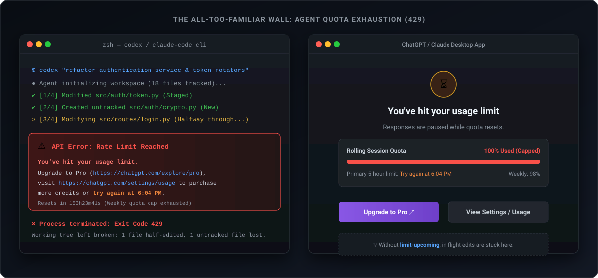
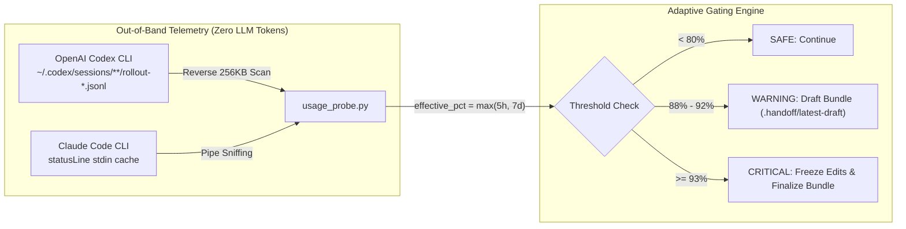
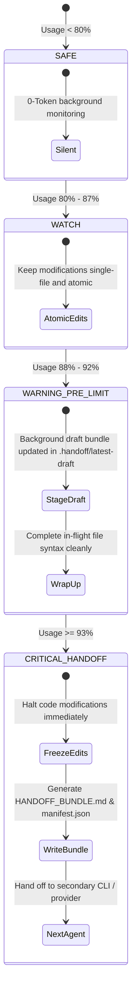

<div align="center">

# ⚡ limit-upcoming

### **AI 코딩 에이전트의 429 쿼터 한도 직전, 코드가 깨지지 않게 0-Token으로 작업 상태를 묶어주는 로컬 인계 도구**

<p align="center">
  <a href="README.md">English</a> • <b>한국어</b>
</p>

[](https://www.python.org/)
[](https://opensource.org/licenses/MIT)
[](#how-it-works)
[](#honest-boundaries)
[](https://github.com/dukjoon/limit_upcoming/pulls)

<p align="center">
  <a href="#the-problem">왜 만들었나</a> •
  <a href="#key-features">핵심 요약</a> •
  <a href="#quick-start">30초 시작하기</a> •
  <a href="#how-it-works">0-Token 감지 원리</a> •
  <a href="#architecture">아키텍처</a> •
  <a href="#cli-reference">CLI 명령어</a> •
  <a href="#honest-boundaries">솔직한 기술 명세</a>
</p>

<p align="center">
  
</p>

</div>

---

## 💥 왜 만들었나: 리팩터링 도중 맞닥뜨리는 "429 참사" <a id="the-problem"></a>

Codex CLI나 Claude Code 같은 AI 코딩 에이전트에 큰 리팩터링을 맡겨두고 커피를 마시러 갔다가, 돌아왔을 때 이런 상황을 겪어보신 적 있을 겁니다.

1. **반쯤 고치다 만 코드 (Broken Working Tree)**: 파일 5개를 손대야 하는데 2개만 건드린 상태에서 사용량 한도(429 또는 주간 쿼터 초과)에 걸려 에이전트가 뻗어버립니다. 문법 에러투성이에 빌드조차 안 도는 코드가 남습니다.
2. **사라져버린 맥락 (Context Annihilation)**: 다른 CLI나 새 세션을 켜도, 이전 에이전트가 어디까지 작업했고 어디서 테스트가 터졌는지 일일이 사람이 다시 설명해야 합니다.
3. **관찰자 효과의 딜레마 (Observer Effect Trap)**: 쿼터가 얼마나 남았는지 보겠다고 에이전트에게 `/usage`나 상태 확인을 계속 시키면, **그 명령을 처리하는 LLM 호출 자체가 남은 토큰을 더 빨리 깎아먹습니다.**

`limit-upcoming`은 이 문제를 해결하기 위해 만들었습니다. **LLM을 전혀 호출하지 않고(0-Token)** 로컬 디스크에 남은 쿼터 메트릭을 조용히 읽다가, **한계치에 도달하기 직전 안전한 타이밍에 작업 트리와 테스트 결과를 통째로 묶어 다음 에이전트에 넘겨줍니다.**

---

## ✨ 핵심 요약 <a id="key-features"></a>

* 🛡️ **토큰 소모 제로(0-Token) 패시브 감지**: Codex CLI의 세션 JSONL 파일과 Claude Code의 상태라인 파이프를 백그라운드에서 가볍게 훑습니다. API 호출도, 프롬프트 토큰 낭비도 없습니다.
* 📦 **새로 만든 파일까지 남김없이 캡처**:
  * 흔히 쓰는 `git diff`는 추적 중인 수정본만 잡고 새로 만든 파일(Untracked)을 통째로 놓칩니다.
  * `limit-upcoming`은 `git diff`(수정본)와 `git diff --cached`(스테이징)는 물론, **새로 추가된 파일 내용 전문까지 단일 문서(`HANDOFF_BUNDLE.md`)에 빠짐없이 담아냅니다.**
  * `.env` 같은 비밀 키 파일이나 바이너리, 대용량 파일은 자동으로 걸러내고 `manifest.json`에 제외 사유를 정직하게 남깁니다.
* 🚦 **단계별 세이프가드 (Adaptive Gating)**:
  * `80% 미만 (SAFE)`: 아무런 간섭 없이 조용히 넘어갑니다.
  * `88% ~ 92% (WARNING)`: 백그라운드에 임시 드래프트 번들(`.handoff/latest-draft/`)을 떠두고, 지금 손대고 있는 파일만 깔끔하게 마무리하도록 유도합니다.
  * `93% 이상 (CRITICAL)`: 코드가 반쪽짜리로 깨지는 걸 막기 위해 **새 코드 수정을 즉시 멈추고(Freeze)**, 후속 에이전트에 넘길 최종 인계 번들을 만듭니다.
* 🧪 **테스트 결과 가감 없이 기록**: `pytest`나 `npm test` 같은 검증 명령을 돌려보고 종료 코드, stdout, stderr, 실행 시간을 있는 그대로 번들에 첨부합니다.

---

## 🚀 30초 시작하기 <a id="quick-start"></a>

### 1. 설치

무거운 외부 라이브러리 없이 Python 3 표준 라이브러리만으로 가볍게 돌아갑니다.

```bash
git clone https://github.com/dukjoon/limit_upcoming.git
cd limit_upcoming
pip install -e .
```

### 2. 남은 사용량 확인 (0-Token Probe)

LLM 토큰을 쓰지 않고 0.05초 만에 쿼터 상태를 읽어옵니다:

```bash
# 한 줄 요약 (에이전트 컨텍스트를 아낄 때 좋습니다)
limit-upcoming probe --compact
# 출력 예시: [codex] Used: 95.0% | Tier: CRITICAL_HANDOFF | Action: FREEZE_EDITS_AND_BUNDLE

# 상세 JSON 출력
limit-upcoming probe --json
```

### 3. 현재 작업 상태 즉시 번들링 (Bundle)

지금 작업 중인 워킹 트리와 새로 만든 파일, 테스트 실패 결과를 한 번에 마크다운 번들로 묶습니다:

```bash
limit-upcoming bundle \
  --goal "JWT 인증 미들웨어 구현" \
  --notes "auth.py 수정 끝남. routes/login.py 작성 중인데 test_login에서 터짐" \
  --verify-cmd "pytest tests/test_auth.py"
```

### 4. 위험한 대규모 수정 전 가드 걸기 (Guard)

훅 스크립트나 체크포인트에 걸어두고 쓰는 명령어입니다:

```bash
limit-upcoming guard \
  --goal "DB 마이그레이션 및 대규모 리팩터링" \
  --warning-threshold 88.0 \
  --critical-threshold 93.0
```

---

## 🔍 0-Token 감지 원리 <a id="how-it-works"></a>



### 왜 에이전트에게 `/usage`를 치게 하면 안 될까요?
| 구분 | 토큰 소모 | 문제점 |
| :--- | :--- | :--- |
| **LLM에게 `/usage` 시키기** | 턴당 500 ~ 2,000 토큰 | 사용량 보려다가 쿼터를 다 써버려서 정작 코드 고치다 429로 뻗음 |
| **`limit-upcoming`** | **0 토큰 (순수 로컬 파일 리딩)** | LLM 상태와 무관하게 5시간 윈도우와 주간 쿼터 둘 다 선제 감지 |

> [!NOTE]
> Codex CLI는 모델 응답이 올 때마다 로컬 JSONL 파일에 실시간 쿼터(`primary` 5시간 사용률, `secondary` 7일 사용률)를 기록합니다. `limit-upcoming`은 파일 전체를 무식하게 읽지 않고, 파일 끝 256KB만 역방향으로 훑어 필요한 숫자만 꺼내옵니다.

---

## 🏗️ 아키텍처 <a id="architecture"></a>



---

## 📦 번들 폴더엔 뭐가 들어가나 <a id="whats-inside"></a>

명령어를 실행하면 `.handoff/bundle-<날짜_시간>/` 폴더 아래 깔끔하게 정리되어 들어갑니다:

```text
.handoff/bundle-20261103_150444/
├── HANDOFF_BUNDLE.md          # 📄 다음 에이전트에게 그대로 프롬프트로 넘겨줄 단일 마크다운
├── manifest.json              # 🤖 기계 판독용 상세 메타데이터 (크기, 소요시간, 해시)
├── patches/
│   ├── unstaged.diff          # 🔄 git diff 내용
│   └── staged.diff            # 📌 git diff --cached 내용
└── untracked_files/
    └── src/new_module.py      # 📝 새로 생성된 파일 원본 복사본
```

### 번들 마크다운(`HANDOFF_BUNDLE.md`) 예시 미리보기

````markdown
# Handoff Evidence Bundle
- **생성 시각**: `2026-11-03T06:04:44Z` | **브랜치**: `main`
- **사용량 상태**: `codex` | 실질 사용률: `95.0%` | 등급: `CRITICAL_HANDOFF`

## 1. 작업 목표 & 현재 상황
**목표**: 사용자 인증 플로우 구현
**진행 상황**: auth 서비스는 완성했고, login 라우트 테스트 42번째 줄에서 assertion 실패 나는 중.

## 2. 작업 트리 변경 내역
### 수정된 내용 (`git diff`)
```diff
...
```
### 새로 만든 파일 전문
#### 파일: `src/auth_helpers.py`
```python
def hash_password(pwd: str) -> str:
    ...
```

## 3. 검증 명령어 실행 결과
### 실행 명령: `pytest tests/test_auth.py`
- **결과**: `FAIL (exit 1)` | **소요 시간**: `450 ms`
```text
FAILED tests/test_auth.py::test_jwt_expiration - AssertionError: Token not expired
```

## 4. 다음 에이전트를 위한 인계 지침
1. `tests/test_auth.py`의 만료 시간 검증 로직부터 수정하세요.
2. 새로 추가된 `src/auth_helpers.py`를 `routes/auth.py`에 import해서 이어가세요.
````

---

## 🛠️ CLI 명령어 요약 <a id="cli-reference"></a>

```text
usage: limit-upcoming [-h] {probe,bundle,guard,hook-statusline} ...

서브커맨드:
  probe             로컬 0-Token 사용량 확인 (Codex / Claude)
                    옵션: --compact, --json, --provider {auto,codex,claude}

  bundle            현재 상태를 로컬 증거 번들로 즉시 생성
                    옵션: --goal "...", --notes "...", --verify-cmd "...", --out-dir ...

  guard             사용량 임계치를 보고 드래프트 또는 최종 번들 조건부 생성
                    옵션: --warning-threshold 88.0, --critical-threshold 93.0, --adapter "..."

  hook-statusline   Claude Code 상태라인 출력을 가로채 로컬에 캐싱하는 파이프 유틸리티
```

---

## ⚖️ 솔직한 기술 명세: 되는 것과 안 되는 것 <a id="honest-boundaries"></a>

화려한 마케팅 문구나 "알아서 100% 자율 복구한다"는 식의 과장은 하지 않습니다. 이 도구가 정확히 어디까지 보장하는지 투명하게 밝힙니다.

> [!IMPORTANT]
> **핵심 명세 규약**
> `limit-upcoming`은 현재 워킹 트리 상태와 사용자가 지정한 검증 명령 결과를 파일로 모아주는 **로컬 번들링 도구**입니다. LLM의 내부 메모리나 세션 상태 자체를 이식해 주지 않으며, 번들을 전달받은 다음 에이전트가 무조건 성공한다는 보장도 하지 않습니다. `0-Token`이라는 표현은 **번들을 만들고 로컬 쿼터를 읽는 과정에서 LLM을 호출하지 않는다**는 뜻이며, 다음 에이전트가 이 번들을 읽고 작업을 이어갈 때는 당연히 모델 토큰이 소모됩니다.

### 보장하는 점
* ✅ **완전한 로컬 동작**: 번들을 만들거나 사용량을 잴 때 외부 LLM API를 단 한 번도 부르지 않습니다.
* ✅ **새 파일 누락 방지**: 일반 `git diff`에서 증발하는 신규 텍스트 파일 내용을 온전히 담아냅니다.
* ✅ **비밀 키 보호**: `.env*`, `*.pem`, `*.key` 같은 민감한 파일은 번들 본문에서 빼고 `excluded_files` 목록에 제외 사유를 명시합니다.
* ✅ **컨텍스트 폭증 방지**: 거대한 세션 로그를 통째로 읽지 않고 끝부분 256KB 버퍼만 스캔합니다.

### 보장하지 않는 점
* ❌ 다음 에이전트가 사람의 개입 없이 코딩을 100% 끝마친다고 약속하지 않습니다.
* ❌ 각 AI CLI마다 제각각인 세션 히스토리를 하나의 완벽한 공통 규격으로 역파싱하지 않습니다. (작업 목표 `--goal`을 핵심 기준으로 삼습니다).
* ❌ 검증 명령(`--verify-cmd`)은 로컬 환경과 네트워크 상태에 따라 결과가 달라질 수 있습니다. 본 도구는 그 결과를 가감 없이 기록하는 역할만 합니다.

---

## 🧪 테스트 실행 <a id="benchmark"></a>

로컬 단위 테스트는 1초도 안 걸려서 끝납니다:

```bash
PYTHONPATH=src python3 -m unittest discover -s tests -v
# Ran 9 tests in 0.685s (OK)
```

다중 에이전트 인계 벤치마크 설계는 [docs/EXPERIMENT_PROTOCOL.md](docs/EXPERIMENT_PROTOCOL.md)에서 확인하실 수 있습니다.

---

## 🤝 기여하기 <a id="contributing"></a>

버그 제보와 기능 제안은 언제나 환영합니다! PR을 보내시기 전 [docs/SPEC.md](docs/SPEC.md)를 읽어보시고, 로컬 우선·제로 오버헤드라는 프로젝트 방향성에 맞는지 확인해 주세요.

1. 저장소 Fork
2. 브랜치 생성 (`git checkout -b feat/awesome-probe`)
3. 테스트 추가 및 실행 (`python3 -m unittest discover -s tests`)
4. 커밋 (`git commit -m 'feat: add support for local probe xyz'`)
5. 푸시 (`git push origin feat/awesome-probe`)
6. Pull Request 생성

---

## 📄 라이선스 <a id="license"></a>

**MIT License**에 따라 자유롭게 사용하실 수 있습니다. 자세한 내용은 `LICENSE` 파일을 확인하세요.
