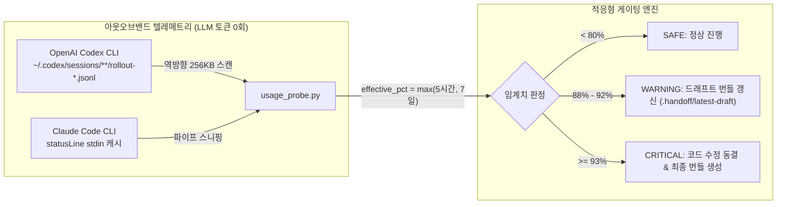
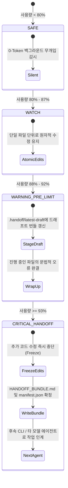

<div align="center">

# ⚡ limit-upcoming

### **AI 코딩 에이전트를 위한 결정론적 로컬 증거 번들 생성 및 선제적 Usage 쿼터 인계 도구**

<p align="center">
  <a href="README.md">English</a> • <b>한국어</b>
</p>

[](https://www.python.org/)
[](https://opensource.org/licenses/MIT)
[](#how-it-works)
[](#honest-boundaries)
[](https://github.com/dukjoon/limit_upcoming/pulls)

<p align="center">
  <a href="#the-problem">문제 정의</a> •
  <a href="#key-features">주요 기능</a> •
  <a href="#quick-start">빠른 시작</a> •
  <a href="#how-it-works">0-Token 감지 원리</a> •
  <a href="#architecture">아키텍처</a> •
  <a href="#cli-reference">CLI 레퍼런스</a> •
  <a href="#honest-boundaries">기술적 경계 및 명세</a>
</p>

</div>

---

## 💥 해결하고자 하는 문제: "리팩터링 도중 터지는 429 참사" <a id="the-problem"></a>

AI 코딩 에이전트(Codex, Claude Code 등)를 사용하다가 API 사용량 한도 초과(`HTTP 429` 또는 구독 롤링 윈도우 소진)가 발생하면 다음과 같은 심각한 문제가 발생합니다:

1. **깨진 워킹 트리 (Broken Working Tree)**: 에이전트가 파일 5개 중 2개만 수정한 상태에서 작업이 강제 중단되어, 문법 에러가 발생하고 빌드가 깨집니다.
2. **맥락 소실 (Context Annihilation)**: 다음에 실행된 새로운 에이전트는 이전 에이전트가 무엇을 하려 했는지, 어떤 파일이 반쪽만 수정되었는지 전혀 알지 못합니다.
3. **관찰자 효과의 함정 (Observer Effect Trap)**: 사용량을 확인하겠다고 에이전트에게 매 턴 `/usage`나 LLM 질의를 시키면, **그 확인 질의 자체가 남아있는 쿼터를 더 빠르게 고갈**시킵니다.

`limit-upcoming`은 **LLM 토큰을 단 1개도 소비하지 않고(0-Token) 로컬 쿼터 메트릭을 패시브하게 감지**하여, **쿼터가 바닥나기 전 안전한 작업 경계에서 원자적 로컬 인계 번들을 선제적으로 생성**합니다.

---

## ✨ 주요 기능 <a id="key-features"></a>

* 🛡️ **0-Token 패시브 쿼터 감지**: Codex CLI의 로컬 세션 JSONL 및 Claude Code의 상태라인 파이프라인을 아웃오브밴드(Out-of-band)로 읽습니다. LLM API 호출 0회, 프롬프트 토큰 오버헤드 0을 보장합니다.
* 📦 **완전한 Git 워킹 트리 보존**:
  * 추적 파일의 **Unstaged 수정 내역**(`git diff`)과 **Staged 변경 내역**(`git diff --cached`)을 완벽히 분리 보존합니다.
  * 일반 `git diff`가 완전히 누락시키는 **신규 생성 파일(Untracked Files)**의 소스 코드 전문을 번들에 수록합니다.
  * 민감한 시크릿 파일(`.env*`, 키 파일), 바이너리 파일, 대용량 파일은 자동 필터링하며 `manifest.json`에 명확한 제외 사유를 기록합니다.
* 🚦 **적응형 임계치 기반 게이팅**:
  * `< 80% (SAFE)`: 오버헤드 제로, 조용한 백그라운드 상태.
  * `88% ~ 92% (WARNING)`: 백그라운드 선제 드래프트 번들(`.handoff/latest-draft/`) 자동 갱신.
  * `≥ 93% (CRITICAL)`: 불완전 코드를 방지하기 위해 **추가 수정을 즉시 동결(Freeze)**하고, 최종 `HANDOFF_BUNDLE.md`를 확정하여 다음 에이전트로의 인계를 안내합니다.
* 🧪 **결정론적 로컬 증거 기록**: 사용자가 지정한 검증 명령(예: `pytest`, `npm test`)을 실행하고, 종료 코드, 표준 출력, 에러 출력, 소요 시간을 왜곡 없이 있는 그대로 캡처합니다.

---

## 🚀 빠른 시작 <a id="quick-start"></a>

### 1. 설치

외부 무거운 의존성 제로! Python 3 표준 라이브러리만으로 100% 작동합니다.

```bash
git clone https://github.com/dukjoon/limit_upcoming.git
cd limit_upcoming
pip install -e .
```

### 2. 로컬 쿼터 상태 확인 (0-Token Probe)

LLM을 호출하지 않고 0.05초 만에 현재 남은 사용량을 확인합니다:

```bash
# 간이 1줄 출력 (에이전트 컨텍스트 주입 최소화용)
limit-upcoming probe --compact
# [codex] Used: 95.0% | Tier: CRITICAL_HANDOFF | Action: FREEZE_EDITS_AND_BUNDLE

# 전체 JSON 스냅샷 출력
limit-upcoming probe --json
```

### 3. 로컬 증거 번들 즉시 생성 (Bundle)

현재 워킹 트리, 신규 파일, 테스트 실행 결과를 즉시 단일 번들로 패키징합니다:

```bash
limit-upcoming bundle \
  --goal "JWT 인증 미들웨어 구현" \
  --notes "auth.py 수정 완료, routes/login.py 작업 중, test_login 실패 상태" \
  --verify-cmd "pytest tests/test_auth.py"
```

### 4. 위험한 대규모 수정 직전 가드 실행 (Guard)

훅(Hook)이나 작업 체크포인트에서 실행합니다:

```bash
limit-upcoming guard \
  --goal "대규모 아키텍처 리팩터링 작업" \
  --warning-threshold 88.0 \
  --critical-threshold 93.0
```

---

## 🔍 0-Token 감지 원리 <a id="how-it-works"></a>



### 왜 에이전트에게 `/usage`를 직접 치게 하면 안 될까요?
| 방식 | 토큰 소모량 | 문제점 |
| :--- | :--- | :--- |
| **LLM `/usage` 폴링** | 턴당 500 ~ 2,000 토큰 | 쿼터 소진을 가속화하며, 편집 도중 429 에러를 유발함 |
| **`limit-upcoming`** | **0 토큰 (100% 로컬)** | LLM 상태와 무관하며, 5시간 한도 및 주간 한도를 모두 사전 감지 |

> [!NOTE]
> Codex CLI는 매 턴마다 실시간 `rate_limits`(5시간 `primary` 및 주간 `secondary` %)를 로컬 JSONL에 기록합니다. `limit-upcoming`은 파일시스템에서 활성 롤아웃 파일의 끝부분만 직접 읽어 토큰 폭증을 원천 차단합니다.

---

## 🏗️ 아키텍처 및 워크플로우 <a id="architecture"></a>



---

## 📦 생성되는 번들의 내부 구조 <a id="whats-inside"></a>

`.handoff/bundle-<timestamp>/` 디렉터리에 다음 산출물이 생성됩니다:

```text
.handoff/bundle-20261103_150444/
├── HANDOFF_BUNDLE.md          # 📄 후속 에이전트가 바로 읽을 수 있는 자립형 마크다운
├── manifest.json              # 🤖 기계 판독용 메타데이터 및 로컬 지표
├── patches/
│   ├── unstaged.diff          # 🔄 추적 파일의 unstaged 수정 내역
│   └── staged.diff            # 📌 추적 파일의 staged 수정 내역
└── untracked_files/
    └── src/new_module.py      # 📝 신규 생성된 파일의 소스 코드 전문
```

---

## 🛠️ CLI 레퍼런스 <a id="cli-reference"></a>

```text
usage: limit-upcoming [-h] {probe,bundle,guard,hook-statusline} ...

서브커맨드:
  probe             로컬 0-Token 사용량 메트릭 확인 (Codex / Claude)
                    옵션: --compact, --json, --provider {auto,codex,claude}

  bundle            로컬 증거 번들 즉시 생성
                    옵션: --goal "...", --notes "...", --verify-cmd "...", --out-dir ...

  guard             사용량 임계치를 검사하고 조건부로 드래프트/최종 번들 생성
                    옵션: --warning-threshold 88.0, --critical-threshold 93.0, --adapter "..."

  hook-statusline   Claude Code statusline 파이프라인 캐싱 유틸리티
```

---

## ⚖️ 기술적 경계 및 정직한 명세 <a id="honest-boundaries"></a>

우리는 **철저한 기술적 정직성**을 추구합니다. "100% 자율 복구" 같은 모호한 과장 대신, 본 도구의 정확한 동작 규약을 명시합니다:

> [!IMPORTANT]
> **핵심 명세 문구 (Core Specification Statement)**
> `limit-upcoming`은 현재 워킹 트리와 사용자가 선택한 검증 결과를 로컬 인계 번들로 수집하는 도구다. 세션 내부 상태를 이식하거나 다음 에이전트의 동작·성공을 보장하지 않는다. `0-token` 주장은 번들 생성 및 로컬 쿼터 조회 스크립트에만 한정되며, 후속 에이전트가 번들을 읽고 작업을 재개할 때는 모델 호출과 토큰 사용이 발생한다.

### 보장하는 것 (Guarantees)
* ✅ **100% 로컬 실행**: 번들 생성 및 쿼터 확인 중 외부 LLM을 절대 호출하지 않습니다.
* ✅ **신규 파일(Untracked) 수집**: 일반 `git diff`에서 누락되는 신규 텍스트 파일 내용을 번들에 완벽히 담아냅니다.
* ✅ **시크릿 보호**: `.env*`, `*.pem`, `*.key` 등의 시크릿 파일을 번들 본문에서 제외하고, `excluded_files`에 명확한 사유를 기록합니다.
* ✅ **토큰 폭증 방지**: 거대한 JSONL 파일을 256KB 역방향 고정 버퍼로 읽어 컨텍스트 낭비를 방지합니다.

### 보장하지 않는 것 (Non-Guarantees)
* ❌ 후속 에이전트가 사람의 개입 없이 작업을 무조건 성공적으로 끝낼 것을 보장하지 않습니다.
* ❌ 서로 다른 폐쇄형 CLI 세션 로그를 단 하나의 범용 형식으로 완벽 파싱한다고 주장하지 않습니다. (사용자 목표 `--goal`이 기본 진실 원천입니다).
* ❌ 검증 명령(`--verify-cmd`) 실행 결과는 프로젝트 환경과 의존성에 따라 달라질 수 있으므로, 도구는 이를 있는 그대로의 경험적 증거로 기록할 뿐입니다.

---

## 🧪 테스트 및 벤치마크 <a id="benchmark"></a>

로컬 단위 테스트를 1초 이내에 실행할 수 있습니다:

```bash
PYTHONPATH=src python3 -m unittest discover -s tests -v
# Ran 9 tests in 0.685s (OK)
```

다중 에이전트 인계 벤치마크를 위한 상세 실험 프로토콜은 [docs/EXPERIMENT_PROTOCOL.md](docs/EXPERIMENT_PROTOCOL.md)에서 확인하실 수 있습니다.

---

## 🤝 기여 안내 <a id="contributing"></a>

기여는 언제나 환영합니다! PR을 제출하시기 전 [docs/SPEC.md](docs/SPEC.md)를 참고하시어 로컬 우선(Local-first), 제로 오버헤드 철학에 부합하는지 확인해 주시기 바랍니다.

1. 레포지토리 Fork
2. 피처 브랜치 생성 (`git checkout -b feat/awesome-probe`)
3. 테스트 추가 및 실행 (`python3 -m unittest discover -s tests`)
4. 커밋 (`git commit -m 'feat: add support for local probe xyz'`)
5. 브랜치 Push (`git push origin feat/awesome-probe`)
6. Pull Request 생성

---

## 📄 라이선스 <a id="license"></a>

**MIT License**에 따라 배포됩니다. 자세한 내용은 `LICENSE`를 참조하십시오.
