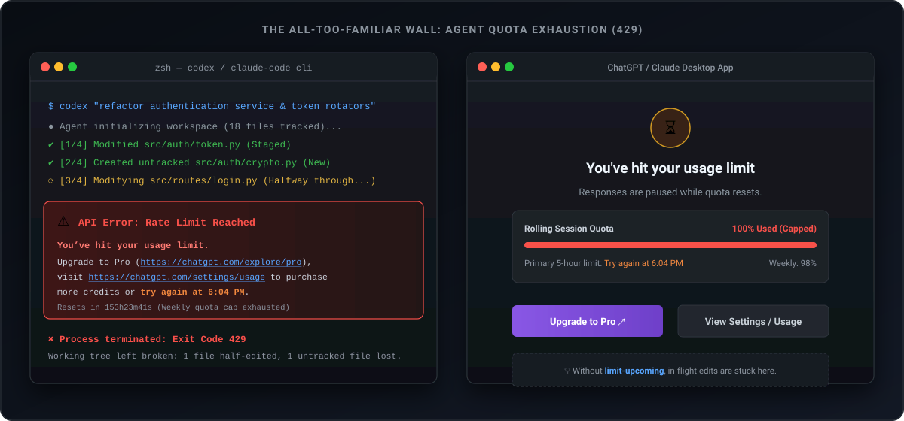
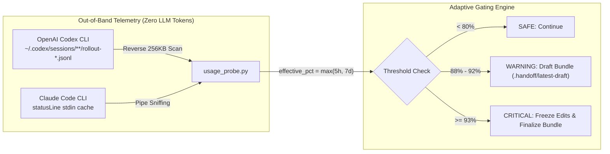
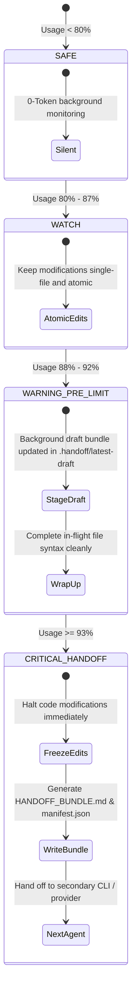

<div align="center">

# ⚡ limit-upcoming

### **Deterministic Local Evidence Bundles & Proactive Usage Limit Handoff for AI Coding Agents**

<p align="center">
  <b>English</b> • <a href="README.ko.md">한국어</a>
</p>

[](https://www.python.org/)
[](https://opensource.org/licenses/MIT)
[](#how-it-works)
[](#honest-boundaries)
[](https://github.com/dukjoon/limit_upcoming/pulls)

<p align="center">
  <a href="#the-problem">The Problem</a> •
  <a href="#key-features">Key Features</a> •
  <a href="#quick-start">Quick Start</a> •
  <a href="#how-it-works">How It Works</a> •
  <a href="#architecture">Architecture</a> •
  <a href="#cli-reference">CLI Reference</a> •
  <a href="#honest-boundaries">Honest Boundaries</a>
</p>

<p align="center">
  
</p>

</div>

---

## 💥 The Problem: The "429 Mid-Refactor Disaster" <a id="the-problem"></a>

When an AI coding agent hits an API quota exhaustion (`HTTP 429` or subscription window reset):
1. **Broken Working Tree**: The agent gets cut off mid-edit (e.g., modified 2 files out of 5), leaving invalid syntax and broken builds.
2. **Context Annihilation**: The next agent launched has no idea what was being attempted, what files were half-written, or why tests failed.
3. **The Observer Effect Trap**: If the agent runs `/usage` or LLM-based queries every turn to monitor quotas, **the monitoring queries themselves burn up the remaining quota faster**.

`limit-upcoming` solves this by **passively reading local quota metrics without burning a single LLM token (0-token)** and **safely staging an atomic handoff bundle before quota exhaustion hits**.

---

## ✨ Key Features <a id="key-features"></a>

* 🛡️ **Zero-Token Passive Quota Sensing**: Reads local JSONL telemetry (Codex CLI) and local statusline pipes (Claude Code) out-of-band. Zero API calls, zero LLM prompt overhead.
* 📦 **Complete Git Working Tree Preservation**:
  * Captures both **unstaged modifications** (`git diff`) and **staged changes** (`git diff --cached`).
  * Captures **new untracked files** with full contents (which `git diff` silently ignores).
  * Automatically filters out sensitive secrets (`.env*`, keys), binaries, and oversized files with a transparent exclusion manifest.
* 🚦 **Adaptive Boundary Gating**:
  * `< 80% (SAFE)`: Zero overhead, silent execution.
  * `88% ~ 92% (WARNING)`: Stages a background rolling draft bundle (`.handoff/latest-draft/`).
  * `≥ 93% (CRITICAL)`: **Freezes further edits** to prevent broken code, finalizes `HANDOFF_BUNDLE.md`, and guides seamless handover to the next agent.
* 🧪 **Deterministic Local Evidence**: Executes user-specified verification commands (e.g., `pytest`, `npm test`) and captures exit codes, stdout, stderr, and execution duration without bias.

---

## 🚀 Quick Start <a id="quick-start"></a>

### 1. Installation

Zero external dependencies! Operates 100% on the Python 3 standard library.

```bash
git clone https://github.com/dukjoon/limit_upcoming.git
cd limit_upcoming
pip install -e .
```

### 2. Check Local Quota (0-Token Probe)

Query current quota utilization instantly (< 50ms) without invoking the LLM:

```bash
# Compact single-line output (ideal for minimal agent context injection)
limit-upcoming probe --compact
# [codex] Used: 95.0% | Tier: CRITICAL_HANDOFF | Action: FREEZE_EDITS_AND_BUNDLE

# Full JSON output
limit-upcoming probe --json
```

### 3. Generate a Local Evidence Bundle

Immediately snapshot the working tree, untracked files, and test results:

```bash
limit-upcoming bundle \
  --goal "Implement JWT authentication middleware" \
  --notes "auth.py updated, routes/login.py partially done, test_login failing" \
  --verify-cmd "pytest tests/test_auth.py"
```

### 4. Guard Before Hazardous Multi-File Edits

Run in your hooks or pre-task checkpoints:

```bash
limit-upcoming guard \
  --goal "Large architectural refactoring" \
  --warning-threshold 88.0 \
  --critical-threshold 93.0
```

---

## 🔍 How 0-Token Probing Works <a id="how-it-works"></a>



### Why not just ask the LLM to run `/usage`?
| Approach | Token Cost | Failure Mode |
| :--- | :--- | :--- |
| **LLM `/usage` loop** | 500 ~ 2,000 tokens / turn | Accelerates quota depletion; causes rate-limit crashes mid-edit |
| **`limit-upcoming`** | **0 tokens (100% Local)** | Independent of LLM state; detects both 5-hour and 7-day limits |

> [!NOTE]
> Codex CLI writes real-time `rate_limits` (`primary` 5-hour % and `secondary` 7-day %) to local JSONL files on every turn. `limit-upcoming` inspects the tail of the active rollout file directly from the filesystem, avoiding runaway token growth.

---

## 🏗️ Architecture & Workflow <a id="architecture"></a>



---

## 📦 What's Inside a Generated Bundle? <a id="whats-inside"></a>

Every bundle produced at `.handoff/bundle-<timestamp>/` contains:

```text
.handoff/bundle-20261103_150444/
├── HANDOFF_BUNDLE.md          # 📄 Self-contained markdown for the next agent
├── manifest.json              # 🤖 Machine-readable metadata & local metrics
├── patches/
│   ├── unstaged.diff          # 🔄 Tracked files unstaged modifications
│   └── staged.diff            # 📌 Tracked files staged modifications
└── untracked_files/
    └── src/new_module.py      # 📝 New files captured with full source code
```

### Sample `HANDOFF_BUNDLE.md` Preview

````markdown
# Handoff Evidence Bundle
- **Created At**: `2026-11-03T06:04:44Z` | **Branch**: `main`
- **Usage State**: `codex` | Effective: `95.0%` | Tier: `CRITICAL_HANDOFF`

## 1. Goal & Context
**Target Goal**: Implement user authentication flow
**In-flight Notes**: Auth service finished; login route tests are failing at line 42.

## 2. Working Tree Changes
### Unstaged Modifications (`git diff`)
```diff
...
```
### Untracked New Files (Complete Contents)
#### File: `src/auth_helpers.py`
```python
def hash_password(pwd: str) -> str:
    ...
```

## 3. Verification Command Outputs
### Command: `pytest tests/test_auth.py`
- **Result**: `FAIL (exit 1)` | **Duration**: `450 ms`
```text
FAILED tests/test_auth.py::test_jwt_expiration - AssertionError: Token not expired
```

## 4. Resumption Instructions for Next Agent
1. Fix the failing assertion in `tests/test_auth.py`.
2. Register `src/auth_helpers.py` in `routes/auth.py`.
````

---

## 🛠️ CLI Reference <a id="cli-reference"></a>

```text
usage: limit-upcoming [-h] {probe,bundle,guard,hook-statusline} ...

Subcommands:
  probe             Check local 0-token usage metrics (Codex / Claude)
                    Options: --compact, --json, --provider {auto,codex,claude}

  bundle            Generate local evidence bundle immediately
                    Options: --goal "...", --notes "...", --verify-cmd "...", --out-dir ...

  guard             Check usage thresholds and conditionally stage draft/final bundle
                    Options: --warning-threshold 88.0, --critical-threshold 93.0, --adapter "..."

  hook-statusline   Non-intrusive pipe utility for Claude Code statusline caching
```

---

## ⚖️ Technical Specification & Boundaries <a id="honest-boundaries"></a>

We believe in **radical technical honesty**. Unlike vague claims of "autonomous 100% recovery", here is our exact operational contract:

> [!IMPORTANT]
> **Core Specification Statement**
> `limit-upcoming` is a local tool that packages the current working tree and user-selected verification outputs into an evidence bundle. It does **not** serialize internal LLM hidden states, nor does it guarantee the execution success of subsequent agents. The `0-token` claim applies strictly to the local bundle creation and local telemetry inspection scripts; subsequent agents will incur model tokens when reading the bundle.

### What It Guarantees
* ✅ **100% Local Execution**: Never hits an external LLM during bundle generation or probing.
* ✅ **Untracked File Capture**: Extracts untracked text files that standard `git diff` drops.
* ✅ **Secret Protection**: Strips `.env*`, `*.pem`, `*.key`, and secret tokens from bundle text, registering them in `excluded_files` with transparent reasons.
* ✅ **Zero Runaway Tokens**: Reads JSONL files in fixed 256KB reverse buffers to prevent massive memory/context bloat.

### What It Does NOT Guarantee
* ❌ Does not guarantee that subsequent agents will solve the task without human intervention.
* ❌ Does not parse closed proprietary session formats across every vendor into a universal AST. (User goals `--goal` are the source of truth).
* ❌ Verification commands (`--verify-cmd`) depend on local project environments and are not strictly deterministic; `limit-upcoming` captures outputs faithfully as empirical evidence.

---

## 🧪 Benchmark & Verification Suite <a id="benchmark"></a>

Run the full local test suite in sub-second time:

```bash
PYTHONPATH=src python3 -m unittest discover -s tests -v
# Ran 9 tests in 0.685s (OK)
```

Detailed experimental protocols for multi-agent resumption benchmarking can be found in [docs/EXPERIMENT_PROTOCOL.md](docs/EXPERIMENT_PROTOCOL.md).

---

## 🤝 Contributing <a id="contributing"></a>

Contributions are warmly welcomed! Please read our [docs/SPEC.md](docs/SPEC.md) before submitting PRs to ensure new features align with our local-first, zero-overhead philosophy.

1. Fork the repository
2. Create your feature branch (`git checkout -b feat/awesome-probe`)
3. Add tests to `tests/` and verify (`python3 -m unittest discover -s tests`)
4. Commit your changes (`git commit -m 'feat: add support for local probe xyz'`)
5. Push to the branch (`git push origin feat/awesome-probe`)
6. Open a Pull Request

---

## 📄 License <a id="license"></a>

Distributed under the **MIT License**. See `LICENSE` for details.
